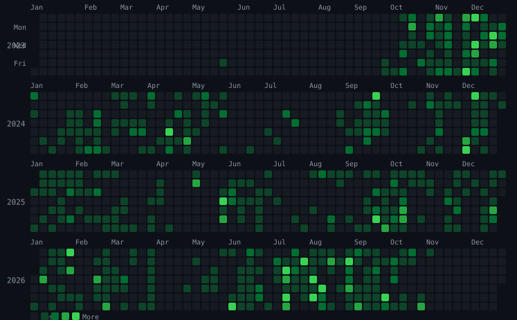

 

 

 

---

## 👋 About Me

I'm **Musfique Ahmed Anik** — a Data Science senior at **United International University (UIU)** and **Founder & President of the UIU Data Science Club**. I build things that turn messy, real-world data into decisions people can trust.

- 🎓 **Studying:** Deep Learning and advanced AI architectures
- 🔭 **Building:** Traffic Management System
- 🏆 **100% Merit Scholarship** recipient at UIU (3 tiers: 25% → 100%)
- 🏛️ **Founder & President**, UIU Data Science Club
- 📝 **Published Researcher** — Sentiment Analysis for Banglish Text (*ICCIT 2024*)
- 👨‍🏫 **Teaching Assistant**, UIU Data Science Department
- 🌌 **Interests:** Space, Photography, and Competitive Programming

Check out my **[full portfolio](https://musfique-ahmed.github.io/portfolio/)** for case studies with measurable outcomes, a leadership timeline, and technical write-ups.

---

## 📊 Impact Snapshot

<table>
<tr>
<td width="50%" align="center"><b>97%</b> Airline model accuracy (Random Forest)</td>
<td width="50%" align="center"><b>1,800+</b> Missing values handled (Banglish NLP dataset)</td>
</tr>
<tr>
<td width="50%" align="center"><b>20</b> Forms automated (Apps Script workflow)</td>
<td width="50%" align="center"><b>3x</b> Scholarship tiers earned (25% → 100%)</td>
</tr>
</table>

---

## 🛠️ Technical Toolbox

  
  
  
  
  
  
  
  
  
  
  
  
  

| Category | Skills |
|:--------:|--------|
| **🔧 Data Engineering** | ETL Pipelines, Selenium, BeautifulSoup, Scrapy, MySQL, PostgreSQL, Docker |
| **📊 Analysis & BI** | Power BI (DAX), Tableau, MS Excel (Power Query), Plotly, Pandas, NumPy |
| **🤖 Machine Learning** | Random Forest, NLP, Deep Learning, LLM Benchmarking (GPT, Gemini, DeepSeek), Hugging Face |
| **🌐 Web & Visualization** | FastAPI, Streamlit, React, TypeScript, Leaflet.js, Tailwind CSS, HTML5 |
| **🧰 Practices** | Git, GitHub Actions, Linux, Data Storytelling, Model Explainability |

---

## 🚀 Featured Projects

<table>
<tr>
<td width="50%" valign="top">
<h3 align="center">⚽ <a href="https://github.com/ik0zy/vizball">Vizball</a> — FIFA Analytics</h3>

Interactive Streamlit toolkit for deep-dive player performance and club composition analysis across multi-year FIFA data.

  
  
  

<a href="https://musfique-ahmed.github.io/portfolio/projects.html">Read case study →</a>

</td>
<td width="50%" valign="top">
<h3 align="center">🗣️ <a href="https://github.com/Musfique-Ahmed/Hate-Speech-Reasoning-Survey">Banglish Hate Speech Detection</a></h3>

Benchmarking LLM reasoning against human judgment in code-mixed Bangla-English text. Published at ICCIT 2024.

  
  
  

<a href="https://musfique-ahmed.github.io/portfolio/all-awards.html">Publication context →</a>

</td>
</tr>
<tr>
<td width="50%" valign="top">
<h3 align="center">🛡️ <a href="https://github.com/Musfique-Ahmed/My-Safety-App">My Safety App</a></h3>

Full-stack safety and crime reporting platform — live incident reporting, emergency access, and map visualization with FastAPI.

  
  
  

<a href="https://musfique-ahmed.github.io/portfolio/projects.html">Read case study →</a>

</td>
<td width="50%" valign="top">
<h3 align="center">🐒 <a href="https://github.com/Musfique-Ahmed/monkeypox-perdition-app">Monkeypox Prediction</a></h3>

Streamlit app predicting Monkeypox infection likelihood using a Random Forest classifier trained on 46 symptoms.

  
  
  

<a href="https://github.com/Musfique-Ahmed/monkeypox-perdition-app">View repo →</a>

</td>
</tr>
<tr>
<td width="50%" valign="top">
<h3 align="center">💰 <a href="https://github.com/Musfique-Ahmed/MoneyPlant">MoneyPlant</a></h3>

Privacy-aware financial decision copilot for SMEs — import records, simulate operating decisions, compare scenarios, and understand trade-offs.

  
  
  

<a href="https://github.com/Musfique-Ahmed/MoneyPlant">View repo →</a>

</td>
<td width="50%" valign="top">
<h3 align="center">🤖 <a href="https://github.com/Musfique-Ahmed/Local-LLM-Chatbot-System">Local LLM Chatbot</a></h3>

Local-first chatbot running entirely on your machine — async TCP server proxying to Ollama with persisted conversation history.

  
  
  

<a href="https://github.com/Musfique-Ahmed/Local-LLM-Chatbot-System">View repo →</a>

</td>
</tr>
<tr>
<td width="50%" valign="top">
<h3 align="center">📚 <a href="https://github.com/Musfique-Ahmed/NoteHub">NoteHub</a></h3>

Collaborative platform for students to share, find, and download class notes — searchable by course, creator, or title.

  
  

<a href="https://github.com/Musfique-Ahmed/NoteHub">View repo →</a>

</td>
<td width="50%" valign="top">
<h3 align="center">✅ <a href="https://github.com/Musfique-Ahmed/Discord-To-Do-List-Bot">Discord To-Do Bot</a></h3>

Slash-command productivity bot with bulk item addition and multiple lists per server, backed by per-server data structures.

  
  

<a href="https://musfique-ahmed.github.io/portfolio/blog-post-5.html">Read write-up →</a>

</td>
</tr>
</table>

### More Projects

| Repo | Description |
|------|-------------|
| [SUST-Hackathon-Mock](https://github.com/Musfique-Ahmed/SUST-Hackathon-Mock) | Full-stack support-ticket demo — sentiment analysis via Hugging Face, persisted in PostgreSQL, all in Docker Compose |
| [Arteum-Team-Project-Eleven](https://github.com/Musfique-Ahmed/Arteum-Team-Project-Eleven) | Immersive Vite + React + TypeScript experience for browsing and uploading emotion-driven digital art |
| [Web-Scrapping-Projects](https://github.com/Musfique-Ahmed/Web-Scrapping-Projects) | Collection of Python scraping projects — BeautifulSoup, Selenium, Scrapy, and Pandas |
| [Shongjog-Python-Course](https://github.com/Musfique-Ahmed/Shongjog-Python-Course) | Curriculum for a 3-month project-based Python course designed for kids |
| [Team_Ura_Dhura_-UrbanFloodBench-Competition](https://github.com/Musfique-Ahmed/Team_Ura_Dhura_-UrbanFloodBench-Competition) | Team entry for the Urban FloodBench competition |
| [UIU-HackDay-2026-Project-Eleven](https://github.com/Musfique-Ahmed/UIU-HackDay-2026-Project-Eleven) | Project from UIU HackDay 2026 — [live demo](https://musfique-ahmed.github.io/UIU-HackDay-2026-Project-Eleven/) |

---

## 🏆 Achievements

- 🥇 **Champion** — Senior Project Display, DRMC Intra Science Festival
- 🥇 **Champion** — Senior Project Display, DRMC National Nature Festival
- 📄 **Published research** — *Sentiment Analysis for Banglish Text*, ICCIT 2024
- 🎖️ **100% Merit Scholarship** — 3 tiers earned (25% → 50% → 100%)
- 🏛️ **Founder & President** — UIU Data Science Club (built from scratch: recruitment, technical sessions, community events)

---

## 💼 Experience

| Role | Organization | Period |
|------|--------------|--------|
| Teaching Assistant, Data Science Dept. | United International University | Feb 2025 – Present |
| President, UIU Data Science Club | United International University | Feb 2025 – Present |
| Project Coordinator Intern | IRIIC, UIU | Sep 2024 – Present |
| Instructor, Programming with Python | Songjog Foundation | Nov 2024 – Mar 2025 |
| NEV Apprenticeship | BYD 2025 | 2025 |

---

## 📈 GitHub Statistics

  
  

  

  

---

## 📫 Let's Connect!

  
  
  
  

---

  

  <i>"Turning data into information, information into insight, and insight into impact."</i>

